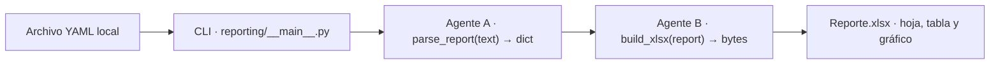
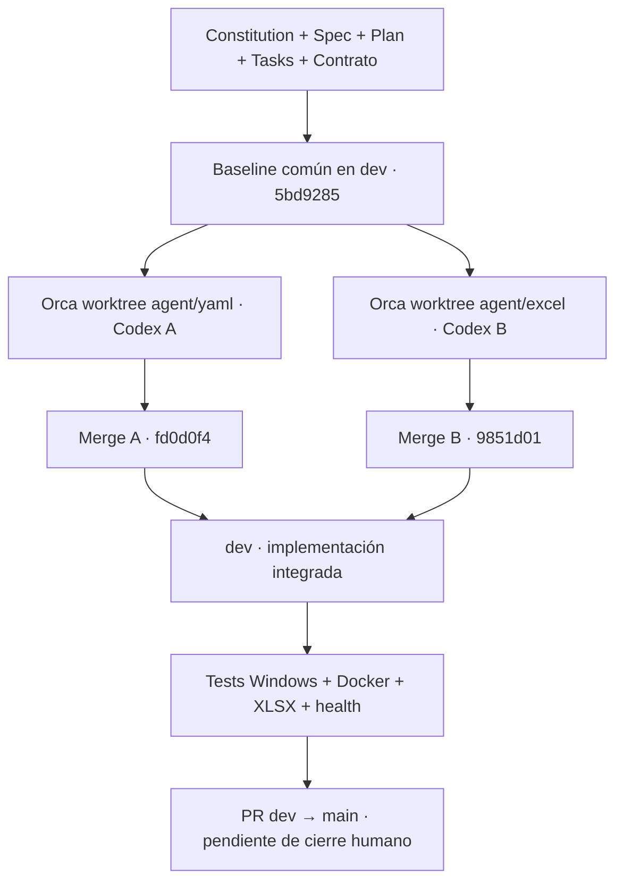

# sdd-multiagent-reporting-experiment

**Spec-Driven Development (SDD) · Orca · 2 agentes Codex · Human in the loop**


> **Estado de la feature 002:** los componentes A (YAML/validación) y B (XLSX/CLI) están integrados en la rama local `dev`. La suite completa pasó con **151 tests en Windows** y **151 tests dentro de Docker Linux**, cada una con **1 advertencia no bloqueante**. Un archivo XLSX fue abierto y revisado visualmente en Excel. El endpoint `/health` respondió HTTP 200 con el JSON esperado. **El PR de `dev` hacia `main` y la conciliación final de tareas no se dan por realizados en este documento.**

Este repositorio documenta un experimento práctico, no una plantilla de arquitectura ni un producto listo para producción. Su pregunta central es si la trazabilidad y el control proporcionados por SDD justifican el esfuerzo de especificación y coordinación para una herramienta deliberadamente pequeña.

## Índice

- [sdd-multiagent-reporting-experiment](#sdd-multiagent-reporting-experiment)
  - [Índice](#índice)
  - [Qué hace el proyecto](#qué-hace-el-proyecto)
  - [Resultados y evidencias](#resultados-y-evidencias)
    - [Validación final observada](#validación-final-observada)
    - [Integración Git registrada](#integración-git-registrada)
    - [Incidencias observadas](#incidencias-observadas)
  - [Arquitectura y contrato](#arquitectura-y-contrato)
    - [Presentación VQ](#presentación-vq)
  - [Requisitos e instalación en Windows](#requisitos-e-instalación-en-windows)
  - [Generar un XLSX desde YAML](#generar-un-xlsx-desde-yaml)
    - [Qué debe verse en Excel](#qué-debe-verse-en-excel)
  - [Ejecutar las pruebas](#ejecutar-las-pruebas)
  - [Docker: build, CLI, pruebas y salud](#docker-build-cli-pruebas-y-salud)
    - [1. Verificar el motor Linux](#1-verificar-el-motor-linux)
    - [2. Construir las imágenes](#2-construir-las-imágenes)
    - [3. Ejecutar la suite dentro del contenedor](#3-ejecutar-la-suite-dentro-del-contenedor)
    - [4. Consultar la ayuda de la CLI dentro de Docker](#4-consultar-la-ayuda-de-la-cli-dentro-de-docker)
    - [5. Generar y recuperar el XLSX en Windows](#5-generar-y-recuperar-el-xlsx-en-windows)
    - [6. Verificar `GET /health` dentro de Docker](#6-verificar-get-health-dentro-de-docker)
  - [Seguridad y límites del alcance](#seguridad-y-límites-del-alcance)
  - [Errores comunes y soluciones](#errores-comunes-y-soluciones)
  - [Gobernanza y trazabilidad multiagente](#gobernanza-y-trazabilidad-multiagente)
    - [Artifacts SDD](#artifacts-sdd)
  - [Histórico: incremento 001](#histórico-incremento-001)
  - [Visión futura, fuera de alcance](#visión-futura-fuera-de-alcance)

## Qué hace el proyecto

La **feature 002 — `yaml-excel-reports`** toma un documento YAML local, valida su contenido y genera un archivo Excel `.xlsx` mediante una CLI, sin servicios externos ni persistencia de datos.

El MVP implementado permite:

- Recibir una definición YAML con `schema_version`, `title`, `headers`, `rows` y `chart`.
- Validar estructura, tipos, dimensiones, referencias de columnas y números antes de generar el archivo.
- Generar una hoja de Excel llamada `Reporte`, con una tabla llamada `Datos`, un título y un gráfico de columnas verticales (`column`).
- Aplicar una paleta fija asociada a VQ Engineering.
- Ejecutar la CLI localmente y dentro de un contenedor Linux.
- Mantener el endpoint independiente `GET /health` del incremento 001.

**No incluye** una API para generación de reportes, autenticación, base de datos, subida de archivos, imágenes ni tipos adicionales de gráficos. Esas posibilidades corresponden a una visión futura, no al alcance implementado de la feature 002.

## Resultados y evidencias

### Validación final observada

| Comprobación | Evidencia / resultado |
|---|---|
| Análisis SDD previo | 17/17 requisitos cubiertos (100 %); 29 tareas definidas; 38 dependencias consistentes; 0 hallazgos pendientes. |
| Agente A, aislado | 120 tests aprobados; `parse_report(text: str) -> dict`. |
| Agente B, aislado | 26 tests aprobados, 1 prueba omitida por falta de integración con A. |
| Merge de ambos agentes | Sin conflictos Git; ambos commits son ancestros de `dev`. |
| Suite completa en Windows | **151 passed, 1 warning**, 0 pruebas omitidas, **8.81 s**. |
| Pruebas específicas de integración | **5 passed**, **1.40 s**, incluido ejemplo real y CLI. |
| Pruebas específicas de CLI | **13 passed**, **0.17 s**. |
| Inspección humana del XLSX | Excel abrió el reporte y se visualizaron título, tabla, filas y gráfico de ventas Norte 120 / Sur 90 con colores VQ. |
| Docker Desktop | Motor Linux disponible, Engine **29.8.2**, contexto `desktop-linux`. |
| Imagen `test` | Build completado y ejecución Linux: **151 passed, 1 warning**, 0 omitidos, **6.21 s**. |
| `GET /health` | Tres respuestas HTTP 200 exactas en la validación local del agente B; se comprobó también HTTP 200 y `{"status":"ok"}` al probar el contenedor. |
| Exportación `report-docker.xlsx` | Se documenta el comando correcto. La conversación suministrada no incluye una salida independiente de `Test-Path` ni captura de ese archivo; verificarlo antes de registrar esta comprobación como cerrada. |

Los resultados de las suites específicas forman parte de las **151 pruebas finales**: no deben sumarse al total. La advertencia corresponde a una deprecación de `starlette.testclient` relacionada con HTTPX; no produjo fallos.

### Integración Git registrada

| Hito | Commit / rama |
|---|---|
| Línea base SDD compartida | `5bd9285` |
| Agente A — YAML y validación | `a23aa73` — `agent/yaml` |
| Agente B — XLSX y CLI | `6b20d39` — `agent/excel` |
| Merge del agente A en `dev` | `fd0d0f4` |
| Merge del agente B en `dev` | `9851d01` |

Durante la implementación paralela no se reportaron cambios al contrato ni modificaciones de archivos propiedad del otro agente. Los dos desarrollaron en **Git worktrees independientes**, partiendo del mismo commit aprobado. La integración y las verificaciones se realizaron en `dev` bajo control humano.

### Incidencias observadas

| Momento | Incidencia | Resolución / interpretación |
|---|---|---|
| A | Permisos de caché de `uv`. | Se autorizó la ejecución necesaria; las pruebas terminaron correctamente. |
| A | Dos errores iniciales de preparación de tests con identificadores largos. | El agente ajustó las pruebas; ejecución final: 120 aprobadas. |
| B | Acceso a caché de `uv`. | Reintento autorizado y validaciones completadas. |
| B | Error de comillas en un sondeo HTTP desde PowerShell. | Se corrigió el comando y se obtuvieron respuestas HTTP 200. |
| Docker, primera validación | Daemon Linux no disponible. | Se inició Docker Desktop y se verificó el motor Linux. |
| Docker, CLI | `--entrypoint python` usó el intérprete global y no encontraba `xlsxwriter`. | Las dependencias están en `/app/.venv`; usar `uv run ...` o `/app/.venv/bin/python`. |
| Docker, CLI | Se enviaron rutas posicionales. | La CLI exige las opciones **`--input` y `--output`**. |

Los dos últimos errores fueron de los **comandos de comprobación utilizados después de la implementación**, no evidencia por sí mismos de defectos del generador. No se atribuyen a Codex B sin sustento.

## Arquitectura y contrato

El contrato congelado de la feature se encuentra en [specs/002-yaml-excel-reports/contracts/report-v1.md](specs/002-yaml-excel-reports/contracts/report-v1.md). El modelo está documentado en [data-model.md](specs/002-yaml-excel-reports/data-model.md).



**Interfaz entre componentes:**

- `parse_report(text: str) -> dict` realiza la validación y normalización; recibe texto, no una ruta de archivo.
- `build_xlsx(report: dict) -> bytes` consume los datos ya validados, sin mutar el modelo ni escribir archivos.
- La CLI lee el archivo YAML local, llama a las dos funciones y escribe los bytes del XLSX en una ruta de salida nueva.
- Modelo normalizado: `schema_version`, `title`, `headers`, `rows` y `chart`; las referencias de columnas utilizan índices desde cero.
- Números: validación del escalar original con `Decimal`, rango inclusivo ±1.000.000.000 y máximo de 15 cifras significativas antes de convertir al tipo de salida. Se rechazan NaN, infinito y pérdidas de precisión como `1.0000000000000001`.
- Errores: el contrato distingue validación, generación y errores de la CLI; el código de salida documentado de la CLI es 0 para éxito, 1 para problemas de archivos/generación y 2 para errores de validación/uso según corresponda.

### Presentación VQ

| Uso | Color |
|---|---|
| Azure: encabezados y barras | `#0078D4` |
| Navy: título/texto principal | `#0F172A` |
| Violeta: acento reservado | `#6D5DF6` |
| Fondo alternado azul claro | `#EAF2FF` |
| Blanco | `#FFFFFF` |
| Bordes | `#E2E8F0` |

La paleta está centralizada en `reporting/palette.py`, no se configura desde el YAML. **El violeta pertenece a la paleta, pero el ejemplo básico no necesita aplicarlo.** No se genera ni se reproduce el logotipo oficial VQ.

## Requisitos e instalación en Windows

Usar **PowerShell**, Git, **Python 3.12** y **uv** (el Dockerfile fija uv `0.12.23`). Para abrir el archivo y validar su composición hace falta una aplicación compatible con XLSX, preferiblemente Microsoft Excel. Para los pasos Docker se requiere Docker Desktop con motor Linux activo.

Desde la raíz del repositorio:

```powershell
# Instalar únicamente si todavía no están disponibles:
winget install --exact --id Python.Python.3.12
winget install --exact --id astral-sh.uv --version 0.12.23

# Abrir otra terminal si se ha modificado PATH.
python --version
uv --version

# No regenerar dependencias: utilizar el lockfile versionado.
uv lock --check
uv sync --locked --python 3.12
uv run --locked --no-sync python -m reporting --help
```

`uv` instala las dependencias del proyecto en `.venv`. No hace falta activar ese entorno manualmente, no se utiliza `requirements.txt` como fuente de dependencias y no es necesario ejecutar `uv lock` para instalar.

## Generar un XLSX desde YAML

**Entrada de ejemplo:** `examples/report.yaml`.

La CLI utiliza **argumentos con nombre**, no rutas posicionales:

```powershell
New-Item -ItemType Directory -Force .\output | Out-Null

uv run --locked --no-sync python -m reporting `
  --input .\examples\report.yaml `
  --output .\output\report.xlsx

Test-Path .\output\report.xlsx
Invoke-Item .\output\report.xlsx
```

El destino debe ser nuevo: **la CLI no sobrescribe un `.xlsx` existente**. Para repetir la prueba, usá otro nombre (por ejemplo `report-integrado.xlsx`) o retiralo de manera consciente. Los reportes de `output/` son resultados generados, no archivos de código que deban versionarse.

### Qué debe verse en Excel

El archivo de ejemplo contiene:

- Hoja `Reporte`.
- Título **Ventas por región**.
- Tabla `Datos` con encabezados **Región** y **Ventas**.
- Dos registros: **Norte / 120** y **Sur / 90**.
- Gráfico de barras verticales con dos columnas que reflejan dichos valores.
- Encabezados Azure y texto blanco; alternancia de filas blanco/azul claro; título Navy; barras Azure.

La captura revisada muestra que Excel abrió el archivo y representó estos elementos. La comprobación visual no sustituye la verificación estructural de fórmulas, referencias y propiedades internas del libro que se realiza en las pruebas automatizadas.

## Ejecutar las pruebas

Suite completa en Windows:

```powershell
uv lock --check
uv sync --locked
uv run --locked python -m pytest -q -rs
```

**Resultado observado después de integrar A y B:**

```text
151 passed, 1 warning in 8.81s
```

Para verificar las fronteras de integración:

```powershell
uv run --locked python -m pytest tests/test_report_integration.py -v -rs
uv run --locked python -m pytest tests/test_report_cli.py -v -rs
```

**Resultados observados:** 5/5 tests de integración y 13/13 tests de la CLI. Entre otros casos se verifican ejemplo real, errores de esquema, texto literal, destino existente y excepciones de archivo/escritura. Los tests de generación comprueban la estructura del XLSX y la vinculación del gráfico a las celdas.

## Docker: build, CLI, pruebas y salud

### 1. Verificar el motor Linux

```powershell
docker version
docker info
```

**Entorno comprobado:** Docker Engine `29.8.2`, Docker Desktop con servidor Linux `linux/amd64`, contexto `desktop-linux`. El primer intento falló porque el daemon Linux todavía no estaba activo; se resolvió al iniciarlo.

### 2. Construir las imágenes

```powershell
docker build --target runtime -t vqm-reporting:final .
docker build --target test -t vqm-reporting:test .
```

La imagen final utiliza las bases Python 3.12 y uv fijadas por digest en `Dockerfile`, construye el entorno con `uv sync --locked --no-dev` y ejecuta la aplicación con el usuario sin privilegios **UID/GID 10001**. La etapa `test` incorpora las dependencias de desarrollo y pruebas.

### 3. Ejecutar la suite dentro del contenedor

```powershell
docker run --rm vqm-reporting:test
```

**Resultado comprobado dentro del contenedor Linux:**

```text
151 passed, 1 warning in 6.21s
```

El aviso continúa siendo el de Starlette/TestClient y HTTPX; no impidió aprobar los tests.

### 4. Consultar la ayuda de la CLI dentro de Docker

La imagen utiliza un entorno virtual ubicado en `/app/.venv`. **No reemplazar el entrypoint por el Python global**, porque este no ve las dependencias instaladas por uv.

```powershell
docker run --rm `
  --entrypoint /app/.venv/bin/python `
  vqm-reporting:final -m reporting --help
```

La ayuda requiere explícitamente `--input` y `--output`.

### 5. Generar y recuperar el XLSX en Windows

Este comando es el procedimiento correcto para reproducir la exportación con un archivo YAML en modo solo lectura y la carpeta `output` montada para escritura:

```powershell
New-Item -ItemType Directory -Force .\output | Out-Null

$reportInput = (Resolve-Path .\examples\report.yaml).Path
$reportOutput = (Resolve-Path .\output).Path

docker run --rm --network none `
  --mount "type=bind,source=$reportInput,target=/input.yaml,readonly" `
  --mount "type=bind,source=$reportOutput,target=/output" `
  vqm-reporting:final `
  uv run --locked --no-sync --no-dev python -m reporting `
  --input /input.yaml `
  --output /output/report-docker.xlsx

Test-Path .\output\report-docker.xlsx
Get-Item .\output\report-docker.xlsx
Invoke-Item .\output\report-docker.xlsx
```

La carpeta de salida debe existir y ser escribible por el UID `10001` del contenedor. En Docker Desktop con carpetas de Windows suele funcionar mediante el montaje; en Linux puede ser necesario ajustar propietario o ACL. **No montar `.venv` del equipo en el contenedor.** El XLSX generado queda directamente en el disco del host.

**Precisión sobre la evidencia:** los comandos Docker de build, pruebas y salud se ejecutaron satisfactoriamente; el material aportado no incluye un resultado explícito de `Test-Path output/report-docker.xlsx` ni una captura identificada como salida Docker. Esta comprobación debe confirmarse antes de marcarla formalmente como cerrada.

Si se necesita extraer el archivo sin montar `output`, también existe esta alternativa:

```powershell
New-Item -ItemType Directory -Force .\output | Out-Null

docker run --name vqm-report-export --network none `
  vqm-reporting:final `
  uv run --locked --no-sync --no-dev python -m reporting `
  --input examples/report.yaml `
  --output /tmp/report.xlsx

docker cp vqm-report-export:/tmp/report.xlsx .\output\report-export.xlsx
docker rm vqm-report-export
```

### 6. Verificar `GET /health` dentro de Docker

El `CMD` de la imagen `runtime` conserva el servicio FastAPI/Uvicorn del incremento 001.

```powershell
docker run --rm -d `
  --name vqm-health-check `
  -p 127.0.0.1:18000:8000 `
  vqm-reporting:final

1..3 | ForEach-Object {
  $response = Invoke-WebRequest `
    -Uri 'http://127.0.0.1:18000/health' `
    -UseBasicParsing
  "HTTP $($response.StatusCode) - $($response.Content)"
}

docker stop vqm-health-check
```

**Salida esperada por solicitud:** `HTTP 200 - {"status":"ok"}`. La captura del proceso de comprobación muestra una respuesta con ese código y contenido después de utilizar Docker. Para repetir la prueba, esperá a que Uvicorn esté listo antes de enviar la primera solicitud.

## Seguridad y límites del alcance

- **Entrada YAML:** análisis seguro y validación de tipos; sin evaluación ni ejecución de tags arbitrarios.
- **Precisión:** límites explícitos y verificación con `Decimal` del escalar original antes de convertirlo a `int`/`float` de salida.
- **Protección de Excel:** texto proporcionado por la entrada se escribe como texto literal, sin permitir fórmulas de usuario ni hipervínculos automáticos.
- **Archivos:** salida nueva; se controla la existencia del destino y se prueban errores de lectura, codificación, permisos y escritura. No se genera un reporte aparentemente correcto con datos inválidos.
- **Persistencia:** no existe base de datos ni carga en servicios remotos; el flujo es local.
- **Red en Docker:** la generación y la suite pueden ejecutarse sin acceso de red después de construir las imágenes.
- **Identidad:** colores VQ como constantes del código. No se acepta una paleta arbitraria desde YAML ni se inventa el logotipo de la marca.
- **Salud:** `GET /health` solo demuestra que el servicio responde; no es un diagnóstico del generador ni un endpoint para obtener XLSX.

## Errores comunes y soluciones

| Síntoma | Causa o acción adecuada |
|---|---|
| `No module named xlsxwriter` con `--entrypoint python` | Se utilizó el Python global. Ejecutar con `uv run ...` o `/app/.venv/bin/python`. No agregar `pip install` dentro del contenedor. |
| `the following arguments are required: --input, --output` | Usar las opciones con nombre, no rutas posicionales. |
| La salida `.xlsx` ya existe | Elegir otro archivo; la CLI no sobrescribe archivos. |
| La carpeta de salida no existe | Crear previamente `output/` o la carpeta destino. |
| Error de escritura o permiso | Verificar permisos del directorio, archivos abiertos y UID del contenedor. |
| YAML inválido (esquema, números o codificación) | Corregir la entrada según `report-v1.md`; no relajar las validaciones para hacer pasar el ejemplo. |
| `uv` no puede acceder a la caché | Autorizar el acceso correspondiente o usar un `UV_CACHE_DIR` propio. |
| Problema TLS con `uv` | Si el certificado del emisor es confiable en el sistema, usar `uv --system-certs sync --locked --python 3.12`. |
| Docker no conecta al daemon | Iniciar Docker Desktop, comprobar `desktop-linux`, `docker version` y `docker info`. |
| Error de puerto ocupado | Usar otro puerto del lado del host, por ejemplo `18000:8000`. |
| Advertencia Starlette/TestClient con HTTPX | Es una deprecación conocida en las dependencias instaladas; las suites verificadas terminaron sin fallos. |

## Gobernanza y trazabilidad multiagente

El experimento utiliza una estrategia con `main` protegido, `dev` como rama de integración y dos **ramas de implementación** en worktrees administrados por Orca. La revisión y aceptación del trabajo corresponde al autor, no a los agentes.

| Participante | Responsabilidad observada |
|---|---|
| **Codex A** (`agent/yaml`) | Parser seguro, validación de estructura y números, normalización y tests. T005, T007, T015 y T017 reportadas en su handoff. |
| **Codex B** (`agent/excel`) | XlsxWriter, paleta VQ, gráfico, CLI, ejemplos, tests, Dockerfile y README. |
| **Orca** | Dos worktrees locales independientes, creados desde el mismo SHA y supervisados por separado. |
| **Autor — human in the loop** | Aprobación SDD, congelación del contrato, revisión de diffs, commits, merges a `dev`, ejecución de pruebas, apertura y revisión del XLSX y decisión sobre el PR. |



### Artifacts SDD

- [Constitution 1.0.0](.specify/memory/constitution.md)
- [Especificación de la feature 002](specs/002-yaml-excel-reports/spec.md)
- [Plan](specs/002-yaml-excel-reports/plan.md)
- [Tareas](specs/002-yaml-excel-reports/tasks.md)
- [Modelo de datos](specs/002-yaml-excel-reports/data-model.md)
- [Contrato `report-v1`](specs/002-yaml-excel-reports/contracts/report-v1.md)

El último análisis SDD previo a implementar informó **17 requisitos cubiertos, 29 tareas, 38 dependencias consistentes y cero hallazgos pendientes**. Eso acredita la **coherencia documental previa**, no que las 29 tareas estén formalmente cerradas. La conciliación final de las tareas y cualquier prueba aún no respaldada por evidencia deben realizarse antes del cierre del PR.

## Histórico: incremento 001

El incremento anterior, `001-health-check`, se utilizó como *smoke test* del flujo de Spec Kit antes de permitir a dos agentes trabajar en paralelo.

- Operación: `GET /health` pública, respuesta HTTP 200 y JSON exacto `{"status":"ok"}`.
- Evidencia histórica: cuatro escenarios de prueba; construcción y comprobación del contenedor en el incremento inicial; registro de problemas de entorno, importación de `app` y correcciones.
- Al **20 de octubre de 2026**, el README original describía **11 de 12 tareas** del incremento 001 como completas y T012 pendiente de revisión humana. **Es una fotografía histórica**, no el estado vigente del conjunto ni una razón para considerar pendiente la integración de la feature 002.

Documentación histórica:

- [Spec 001](specs/001-health-check/spec.md) y [plan](specs/001-health-check/plan.md).
- [Contrato HTTP](specs/001-health-check/contracts/health.openapi.json) y [tareas](specs/001-health-check/tasks.md).
- [Guía de validación](specs/001-health-check/quickstart.md) y [registro de evidencia](specs/001-health-check/validation.md).

El incremento 001 no genera reportes; su endpoint de salud se conserva para evitar regresiones durante la feature 002.

## Visión futura, fuera de alcance

La Constitution plantea como dirección posible un servicio de reportes mediante FastAPI, con definiciones declarativas YAML, imágenes aprobadas por el servidor, más tipos de gráficos y seguridad basada en OAuth2/JWT con identidad OIDC separada.

**Nada de esto debe confundirse con lo implementado actualmente:** la feature 002 funciona como **CLI local**, con validación segura, generación de un XLSX con **gráfico de columnas** y un endpoint `/health` heredado del smoke test. Cualquier ampliación necesitaría otra especificación y aprobación explícita; **no forma parte del cierre de este experimento**.

---

**Autor:** [Víctor Quirós Miranda](https://github.com/quirosmirandavictor) · VQM Engineering  
**Stack demostrado:** Python 3.12 · uv · PyYAML · XlsxWriter · pytest · Docker · Git worktrees · Orca · Codex · SDD.
