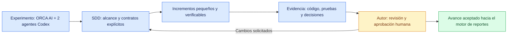
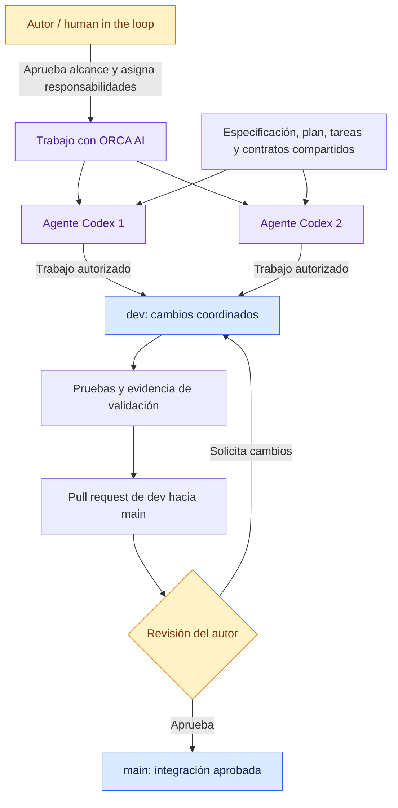
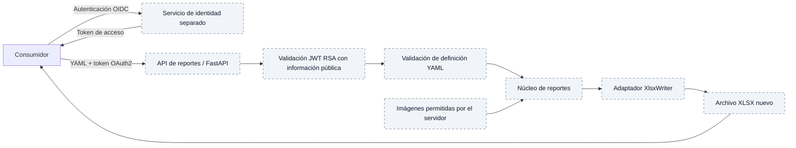

# sdd-multiagent-reporting-experiment

### Desarrollo guiado por especificaciones · ORCA AI · 2 agentes Codex · Human in the loop


[](#colaboración-y-gobernanza)

[](specs/001-health-check/tasks.md)
[](specs/001-health-check/validation.md)
[](specs/001-health-check/validation.md#t012-consolidación-lista-para-revisión-humana)


## Objetivo del experimento

Explorar cómo construir un motor de reportes con **desarrollo guiado por especificaciones (SDD)**, trabajando con **ORCA AI y dos agentes Codex**, bajo la supervisión del autor, [Víctor Quirós Miranda](https://github.com/quirosmirandavictor), como **human in the loop**. El experimento busca observar la trazabilidad entre requisitos, decisiones, tareas, código y pruebas, así como la coordinación entre agentes y las intervenciones humanas necesarias para aceptar cada entrega.

El primer incremento es deliberadamente pequeño: un health check que permite recorrer el flujo SDD y reunir evidencia antes de ampliar el producto. La [Constitución 1.0.0](.specify/memory/constitution.md) establece los principios técnicos y de colaboración.



## Colaboración y gobernanza

El repositorio se trabaja con un modelo protegido: **los agentes solamente pueden trabajar en la rama `dev`**. Los **pull requests son revisados y aprobados por el autor**; `main` recibe los cambios mediante PR con aprobación humana. Los agentes preparan cambios y evidencia; la decisión de aceptación corresponde al autor.

| Participante | Responsabilidad en el experimento |
|---|---|
| ORCA AI | Entorno de trabajo del experimento con los dos agentes Codex. |
| Agentes Codex 1 y 2 | Ejecutar las responsabilidades asignadas de planificación, implementación, validación o revisión sobre los artefactos acordados, dentro de `dev`. |
| Autor / human in the loop | Aprobar el alcance, resolver ambigüedades, revisar resultados y aprobar los PR. |

Si los dos agentes trabajan en paralelo, deben usar árboles de trabajo independientes, con archivos y responsabilidades delimitados. Cada traspaso debe indicar trabajo realizado, archivos afectados, validaciones, decisiones y bloqueantes, conforme al principio XI de la Constitución.



Este diagrama describe el modelo de colaboración del experimento. La evidencia de la primera implementación registra trabajo de un único agente; todavía no acredita una ejecución paralela de ambos agentes.

## Avance al 20 de octubre de 2026

**Health check implementado y validado técnicamente: 11 de 12 tareas completadas.** La revisión humana de T012 y el cierre de SC-003 siguen pendientes. Los badges resumen la evidencia registrada; no representan un estado de CI en vivo ni el porcentaje de avance del motor de reportes.

| Hito | Estado y evidencia |
|---|---|
| Reglas del experimento | Constitución 1.0.0 ratificada: SDD, contratos, simplicidad, aislamiento y revisión humana. |
| Especificación y diseño | Especificación, plan, investigación, modelo de datos y contrato OpenAPI disponibles en [`specs/001-health-check/`](specs/001-health-check/). La autorización operativa está registrada en `validation.md`; el metadato histórico de la especificación conserva `Draft`. |
| Implementación | `GET /health` público con HTTP 200 y JSON exacto `{"status":"ok"}`. |
| Validación funcional | Cuatro escenarios aprobados en local y en contenedor sin red externa; consulta HTTP real sobre la imagen `runtime`. |
| Reproducibilidad | Dependencias bloqueadas con uv, imágenes base fijadas por digest y etapas Docker `base`, `test` y `runtime`. |
| Revisión técnica | Alcance y documentación revisados; imagen final con UID 10001, sin pruebas ni dependencias de desarrollo. |
| Correcciones registradas | Confianza TLS local, permisos de caché uv en Docker e importación de `app` al ejecutar `uv run pytest`; evidencia de fallos y soluciones conservada. |
| Cierre humano | T012 pendiente: revisión del resultado y registro de aprobación o cambios solicitados. La evidencia todavía no registra integración en `dev` ni `main`. |

### Conceptos puestos en práctica

- **SDD y trazabilidad:** especificación → plan → tareas → implementación → validación → revisión humana, con enlaces entre los artefactos.
- **Contrato explícito:** una única operación y respuesta exacta, verificadas desde la frontera HTTP.
- **Ciclo de prueba, fallo y corrección:** fallo inicial por capacidad ausente, implementación mínima y pruebas aprobadas; incidencias posteriores documentadas.
- **Reproducibilidad y mínimo privilegio:** bloqueo de dependencias, contenedores y separación entre pruebas y ejecución.
- **Disciplina de alcance:** cada dependencia y abstracción debe resolver una necesidad actual aprobada.
- **Responsabilidad multiagente y control humano:** trabajo delimitado, traspasos con evidencia y aceptación final a cargo del autor.

## Visión del motor de reportes

La Constitución define como objetivo un API Python/FastAPI que reciba definiciones declarativas YAML y genere archivos XLSX mediante XlsxWriter. El alcance inicial contempla títulos, tablas, imágenes controladas por el servidor y gráficos de líneas, barras, circulares y dona. Las solicitudes protegidas usarán tokens OAuth2/JWT con firma RSA y un servicio de identidad separado basado en OpenID Connect.

**Esta es la arquitectura objetivo; esas capacidades siguen fuera del incremento actual.** Su implementación requiere las especificaciones y aprobaciones correspondientes.



## Capacidad actual: health check mínimo

La única operación cubierta es `GET /health`: responde HTTP 200 y el objeto JSON `{"status":"ok"}`, sin credenciales. Confirma que la consulta fue atendida; no diagnostica el motor de reportes ni otros componentes.

## Requisitos

- Para ejecución local: Python 3.12 y uv 0.12.23.
- Para ejecución reproducible: Docker con motor Linux activo. Las imágenes de Python y uv están fijadas por digest en `Dockerfile`.
- Acceso a los registros durante la instalación o construcción. La consulta no necesita servicios externos.

Los ejemplos usan PowerShell desde la raíz del repositorio. `pyproject.toml` define las dependencias y `uv.lock` conserva el bloqueo completo. Los comandos habituales no regeneran el lock.

## Preparar y probar en local

```powershell
uv lock --check
uv sync --locked --python 3.12
uv run --locked --no-sync python -m pytest -q -p no:cacheprovider
```

Resultado esperado: cuatro pruebas aprobadas para respuesta exacta, acceso público, ausencia de recursos de reportes y tres consultas consecutivas independientes.

Si uv encuentra un emisor TLS desconocido y el certificado es de confianza en el sistema, usar `uv --system-certs sync --locked --python 3.12`. Esta opción fue necesaria en el entorno Windows de validación; no desactiva la comprobación TLS.

## Ejecutar en local

```powershell
$env:UVICORN_HOST = '127.0.0.1'
$env:UVICORN_PORT = '8000'
uv run --locked --no-sync --no-dev python -m uvicorn app:app
```

En otra consola:

```powershell
curl.exe --silent --show-error --fail-with-body --max-time 10 --max-redirs 0 --include http://127.0.0.1:8000/health
```

Se espera HTTP 200, `Content-Type: application/json` y el objeto indicado. Detener el servidor con Ctrl+C. En Linux puede usarse `curl` en lugar de `curl.exe`.

## Construir y validar en Docker

```powershell
docker build --target test -t sdd-health-check:test .
docker run --rm --network none sdd-health-check:test uv run --locked --no-sync python -m pytest -q -p no:cacheprovider
docker build --target runtime -t sdd-health-check:runtime .
docker run --rm --name sdd-health-check-validation -e UVICORN_HOST=0.0.0.0 -e UVICORN_PORT=8000 -p 127.0.0.1:8000:8000 sdd-health-check:runtime
```

Consultar desde otra consola con el mismo comando curl. Al terminar:

```powershell
docker stop sdd-health-check-validation
```

`runtime` ejecuta como UID 10001 y excluye tests y dependencias del grupo `dev`. `test` añade ese grupo y permite verificar los cuatro escenarios sin red externa, volúmenes ni credenciales. Los entornos preparados se ejecutan con `uv run --locked --no-sync`.

## Configuración y dependencias

- `UVICORN_HOST`: dirección de escucha; en Docker el valor predeterminado es `0.0.0.0`.
- `UVICORN_PORT`: puerto interno; predeterminado `8000`. Si se cambia, ajustar también el destino de `-p`.
- Para cambiar solo el puerto del host, usar por ejemplo `-p 127.0.0.1:8081:8000` y consultar el puerto 8081.
- Producción sincroniza con `uv sync --locked --no-dev`; desarrollo usa `uv sync --locked`.
- Al cambiar dependencias, editar `pyproject.toml`, ejecutar `uv lock`, revisar ambos archivos y repetir las validaciones. No hay archivos requirements como fuente principal.

Las pruebas emiten una advertencia de deprecación de Starlette por el uso de HTTPX; las cuatro pasan. Se mantienen las versiones del plan.

## Artefactos y evidencia

- [Especificación](specs/001-health-check/spec.md) y [plan](specs/001-health-check/plan.md).
- [Contrato HTTP](specs/001-health-check/contracts/health.openapi.json) y [tareas](specs/001-health-check/tasks.md).
- [Guía detallada de validación](specs/001-health-check/quickstart.md).
- [Resultados, incidencias y estado de revisión](specs/001-health-check/validation.md).

La implementación y las comprobaciones técnicas están registradas. La revisión humana previa a integración permanece pendiente; no se han integrado cambios en `dev` ni `main`.
