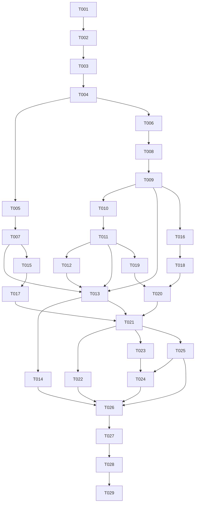

# Tasks: Generación local de reportes XLSX desde YAML

**Input**: [plan.md](plan.md), [spec.md](spec.md), [data-model.md](data-model.md), [contrato v1](contracts/report-v1.md), research.md y quickstart.md.
**Prerequisites**: Diseño revisado, aprobación de alcance y contrato antes de implementación. Esta lista no inicia implementación.
**Tests**: Solicitadas en FR-011 y por el usuario; separar responsabilidad y comprobar integración real.
**Organization**: Historias de spec: US1 (P1) reporte local VQM, US2 (P1) errores/seguridad, US3 (P2) salud.

## Format and ownership

Cada tarea usa checkbox, ID secuencial, [P] solo si permite paralelo con otro ownership y [USn] en fases de historia. Paths de código relativos a raíz; paths SDD completos cuando se editan.

| Ownership | Archivos exclusivos |
| --- | --- |
| A: YAML, validación, normalización | reporting/yaml_input.py; tests/test_report_input.py |
| B: XLSX, gráfico, paleta, CLI, documentación y verificación integrada | reporting/xlsx_output.py; reporting/palette.py; reporting/__main__.py; tests/test_xlsx_output.py; tests/test_xlsx_security.py; tests/test_report_cli.py; tests/test_report_integration.py; examples/report.yaml; README.md; Dockerfile; .dockerignore |
| B: preparación y registro serial | reporting/__init__.py; pyproject.toml; uv.lock; specs/002-yaml-excel-reports/{plan.md,research.md,data-model.md,contracts/report-v1.md,quickstart.md,tasks.md} |

No hay tercer ownership ni edición concurrente de archivos. A entrega evidencia por handoff y no edita registro de B. Cambios en parser se devuelven a A; B no los corrige silenciosamente. App y pruebas de salud existentes se conservan.

## Phase 1: Setup

- [X] T001 B: registrar la aprobación humana explícita de la especificación y del alcance de 002-yaml-excel-reports en specs/002-yaml-excel-reports/tasks.md, recibida el 2026-10-26 del responsable del experimento; ver registro de aprobación al final. La solicitud actual autoriza solo registrar la aprobación, sin iniciar implementación ni declarar congelado el contrato de T004.
- [X] T002 B: resolver y fijar PyYAML/XlsxWriter en pyproject.toml y uv.lock para Python 3.12, conservar uv 0.12.23 y dependencias existentes; ejecutar uv lock --check y uv sync --locked, sin nuevas dependencias de colores o lectura XLSX. Depende de T001.

## Phase 2: Foundational — bloqueo previo al paralelo

- [X] T003 B: crear reporting/__init__.py vacío, sin reexports ni importaciones de escritor/parser; comprobar que no se necesita reporting/model.py o módulo de excepciones. Depende de T002.
- [X] T004 B con revisión de A: registrar en specs/002-yaml-excel-reports/tasks.md el commit aprobado que contiene contracts/report-v1.md, data-model.md, dependencias e inicializador; preparar dos árboles independientes desde ese commit y confirmar firmas parse_report(text: str) -> dict / build_xlsx(report: dict) -> bytes, claves/tipos y propiedad exclusiva. Depende de T003; bloquear paralelo hasta cerrar esta tarea.

**Checkpoint**: Contrato común congelado operativamente por commit registrado y revisado por ambos. Si cambia, detener consumidores, actualizar documentos y revisar antes de continuar.

## Phase 3: US1 — Obtener reporte local VQM (P1)

**Goal**: Del texto YAML a un XLSX con tabla y gráfico correctos.
**Independent Test**: Parser produce dict acordado; constructor acepta ese dict y devuelve libro válido; CLI real ejecuta ejemplo sin API ni red. Inspeccionar datos/estilos/gráfico y abrir en Excel en cierre.

### Tests

- [ ] T005 [P] [US1] A: escribir tests/test_report_input.py para firma parse_report y dict exacto: schema_version:int=1, title:str, headers:list[str], rows:list[list[str|int|float]], chart:dict con type:str=column, category_column:int y value_columns:list[int]; cotejar índices cero basados, orden, acentos, tipos y preservación de textos, sin depender de archivos de B. Depende de T004.
- [ ] T006 [P] [US1] B: escribir tests/test_xlsx_output.py con dict de contrato construido localmente; comprobar bytes completos, no mutación, hoja Reporte, tabla Datos, título A1, encabezados fila 3, datos fila 4, estilos resueltos desde XML, gráfico column y referencias/nombres de series de tabla; usar zipfile/ElementTree, sin openpyxl. Depende de T004.

### Implementation

- [ ] T007 [P] [US1] A: implementar parse_report(text: str) -> dict en reporting/yaml_input.py con SafeLoader, validación antes del retorno y resolución única de nombres a índices; devolver solo claves/tipos de T005, sin E/S, colores, CLI, dataclasses ni importación de XlsxWriter; pasar pruebas válidas T005. Depende de T005.
- [ ] T008 [P] [US1] B: definir los seis colores exactos de FR-005 en reporting/palette.py, única fuente de HEX para consumidores; no frameworks, sobrescritura YAML o logo. Depende de T006; puede coincidir con T007.
- [ ] T009 [US1] B: implementar build_xlsx(report: dict) -> bytes en reporting/xlsx_output.py usando BytesIO/XlsxWriter, cierre completo antes del retorno, sin E/S ni mutación; tabla/column chart referidos a celdas, formato VQM de FR-005, alternancia inicial blanca y barras Azure sin violeta/3D; ajustar anchos/altos/texto y ubicar gráfico debajo de tabla. Pasar T006. Depende de T008.
- [ ] T010 [US1] B: escribir pruebas de argumentos, ayuda, composición parse_report→build_xlsx y éxito en tests/test_report_cli.py, usando sustitutos durante trabajo aislado; afirmar que escribir bytes solo ocurre tras ambas funciones y que stdout contiene ruta absoluta. Depende de T009.
- [ ] T011 [US1] B: implementar reporting/__main__.py con argparse --input/--output, lectura UTF-8, llamadas de contrato y publicación exclusiva xb de bytes completos; códigos 0/1/2, limpieza solo de salida recién creada por esta operación y sin crear padres automáticamente; pasar T010. Depende de T010.
- [ ] T012 [US1] B: añadir examples/report.yaml conforme al ejemplo contractual y verificar que no configura estilos o fórmulas; usarlo como entrada documentada de CLI. Depende de T011.
- [ ] T013 [US1] B: añadir y ejecutar tests/test_report_integration.py con parse_report real de A y build_xlsx real de B, inspección del ZIP/XML y subprocess de CLI sobre YAML temporal; comprobar datos, rangos, series, estilos y contrato no mutado. Depende de T007, T009, T011 y T012; no sustituir integración por mocks.
- [ ] T014 [US1] B: actualizar README.md y specs/002-yaml-excel-reports/quickstart.md con instalación uv, comandos locales, salida esperada, ownership y guía de pruebas por responsabilidad; distinguir comandos previstos de evidencia ejecutada y enlazar contrato sin duplicarlo. Depende de T013.

**Checkpoint**: Demostración funcional US1 verificada. No entregar como feature final antes de cerrar US2, US3 y validación humana.

## Phase 4: US2 — Validación, errores y texto seguro (P1)

**Goal**: Rechazar datos inválidos antes de generar y mantener todo texto como dato.
**Independent Test**: A ejecuta casos inválidos solo sobre texto; B inspecciona bytes con cadenas adversas y prueba CLI/rutas sin depender de UI. Integración verifica que entrada inválida no genera salida.

### Tests

- [ ] T015 [P] [US2] A: ampliar tests/test_report_input.py para cada regla de data-model.md: «entero exacto 1; bool no cuenta como entero»; «cadenas no vacías tras comprobar espacios; conservar texto original»; encabezados «únicos según casefold»; filas «al menos una, longitud idéntica a encabezados»; solo «str/int/float finitos; excluir bool, null, fechas, objetos y estructuras anidadas». Comprobar TypeError si argumento no es str y ValueError contextual para contenido inválido. Depende de T007.
- [ ] T016 [P] [US2] B: crear tests/test_xlsx_security.py para =1+1, +SUM(A1:A2), -SUM(A1:A2), @SUM(A1:A2) y URLs en título/encabezados/datos de texto; verificar cadenas literales, cero fórmulas en celdas, cero enlaces automáticos, números negativos numéricos y referencias internas del gráfico permitidas; comprobar RuntimeError ante fallo de generación sin bytes parciales. Depende de T009.
- [ ] T017 [US2] A: completar en reporting/yaml_input.py y tests/test_report_input.py el rechazo seguro de sintaxis/tags/documentos múltiples y todas las reglas restantes: «Categoría distinta de las series; categorías de texto no vacías»; series «numéricas en cada fila, no vacías y sin repetición»; «caracteres representables en XML 1.0, máximo 32.767 caracteres; encabezados de tabla máximo 255»; números «finitos entre -1.000.000.000 y 1.000.000.000 inclusive, máximo 15 cifras significativas»: preservar escalar/tag original mediante nodos seguros o constructores locales de SafeLoader sin float previo, validar con Decimal antes de convertir, contar cifras sin redondeo de contexto y normalizar a int/float solo después según data-model.md; rechazar NaN, infinito, exceso de rango/cifras y pérdida posterior de conversión, sin reconstruir el original desde yaml.safe_load; añadir regresión explícita que rechace 1.0000000000000001 antes de que pueda redondearse a 1.0, y probar extremos inclusivos, valores fuera del rango, 15/16 cifras y decimales válidos; «máximo 16.384 columnas y 255 series»; «N+28 <= 1.048.576»; «Claves desconocidas o repetidas se rechazan en cualquier objeto». Probar límites y un valor fuera de cada límite, nombres exactos/inexistentes, intento de estilos, sin coerción/redondeo/truncamiento y permitir categorías repetidas, cero y negativos. Depende de T015.
- [ ] T018 [US2] B: completar protección en reporting/xlsx_output.py con write_string para todas las cadenas, strings_to_formulas=False y strings_to_urls=False, escritura numérica explícita y RuntimeError con causa ante fallos; nunca pasar cadenas del YAML como fórmulas o nombres de serie expresados por el usuario. Pasar T016. Depende de T016.
- [ ] T019 [US2] B: ampliar tests/test_report_cli.py con entrada ilegible/UTF-8 inválido, extensión errónea, padre inexistente/no escribible, destino previo y fallo de escritura; comprobar códigos/mensajes de contrato, no traceback esperado, no llamada a build_xlsx tras ValueError y conservación de bytes de destino previo. Depende de T011.
- [ ] T020 [US2] B: completar traducción de ValueError/decodificación, RuntimeError y OSError en reporting/__main__.py; asegurar validación completa antes de build_xlsx y no salida parcial/éxito prematuro; pasar T019. Depende de T019 y T018.
- [ ] T021 [US2] B: ampliar tests/test_report_integration.py con YAML inválido, intento de colores y fórmulas literales en flujo real; cotejar ausencia de salida ante rechazo y preservación de destino existente; ejecutar con parser T017 y constructor T018, sin que B modifique archivos de A. Depende de T013, T017 y T020.
- [ ] T022 [US2] B: registrar en specs/002-yaml-excel-reports/tasks.md el handoff de A y resultados reales de pruebas A/B e integración T021: comandos, commit, conteos, resultado, omisiones, decisiones y bloqueantes; A entrega evidencia sin editar este archivo. Depende de T021.

**Checkpoint**: Definiciones incorrectas se rechazan; contenido de usuario no ejecutable. US2 puede comenzar tras sus productores US1, sin esperar documentación T014.

## Phase 5: US3 — Conservar GET /health (P2)

**Goal**: Mantener la operación existente sin incorporar recursos de reportes.
**Independent Test**: Cuatro pruebas existentes y tres solicitudes HTTP consecutivas sin credenciales con respuesta exacta.

- [ ] T023 [US3] B: ejecutar tests/test_health.py sin cambiar su contrato y revisar app.py para confirmar que no importa reporting ni requiere YAML/XLSX/servicios; registrar resultado en specs/002-yaml-excel-reports/tasks.md. Depende de T021.
- [ ] T024 [US3] B: tras imagen runtime actualizada, ejecutar tres consultas HTTP reales a GET /health sin credenciales y comprobar HTTP 200 y exactamente {"status":"ok"}, sin nuevos endpoints ni dependencias de reporte; registrar comandos/resultados y detener solo contenedor de la prueba en specs/002-yaml-excel-reports/tasks.md. Depende de T023 y T025.

**Checkpoint**: Regresión técnica de salud comprobada; no se exige nuevo código de API.

## Phase 6: Polish & Cross-Cutting Concerns

- [ ] T025 B: actualizar Dockerfile y .dockerignore para incluir reporting/, examples/ y todos los tests de reporte, conservar digests/usuario no root/etapas y CMD de salud, ejecutar CLI con comando runtime sobrescrito y documentar permisos UID 10001; sin nueva imagen base, servicios o instalación durante docker run. Depende de T021.
- [ ] T026 B: ejecutar uv lock --check, suite pytest completa local y Docker test --network none, generación real local y runtime --network none con entrada readonly/salida montada; actualizar README.md y specs/002-yaml-excel-reports/quickstart.md con comandos y resultados, incluyendo restricciones de permisos. Depende de T014, T022, T024 y T025.
- [ ] T027 B: consolidar evidencia de integración en specs/002-yaml-excel-reports/tasks.md, incluyendo commit integrado, versiones bloqueadas, comandos, resultados A/B, regresión salud y errores/omisiones; adjuntar handoffs con trabajo, archivos, validaciones, decisiones y pendientes; no marcar como aprobado lo no ejecutado. Depende de T026.
- [ ] T028 B: solicitar revisión humana abriendo el XLSX del ejemplo en Excel y registrar persona/resultado en specs/002-yaml-excel-reports/tasks.md: sin reparación, título/tabla/gráfico legibles, paleta VQ, sin solapamientos/3D/logo y actualización del gráfico al cambiar dato de tabla; mantener pendiente si no se realiza. Depende de T027.
- [ ] T029 B con revisión de A: cotejar specs/002-yaml-excel-reports/tasks.md contra FR-001–FR-011 y contrato, confirmar archivos sin cambios ajenos ni HEX duplicados, dependencias justificadas y documentación coherente; preparar revisión antes de integración en dev, sin modificar Constitution ni integrar en main automáticamente. Depende de T028.

## Dependencies & Execution Order

US1 puede demostrarse tras T013/T014. US2 se prueba por separado y se integra sobre productores US1; es obligatoria para entrega segura. US3 es una regresión existente; su verificación HTTP requiere Docker T025 aunque esa tarea figure en fase transversal. No hay ciclos: T025 depende de T021, no de US3.

Dentro de cada ownership las tareas que comparten archivo se realizan en serie. [P] indica oportunidad A/B después de dependencias, nunca permiso para dos escritores del mismo archivo o árbol. Tras T004 se permite adelantar T015/T017 mientras B termina US1; no se exige esperar cierre documental de US1.

## Parallel examples

- **US1**: T005 (A/tests parser) junto a T006 (B/tests XLSX); luego T007 (A/parser) junto a T008/T009 (B/paleta y escritor). Dependencias propias primero.
- **US2**: T015/T017 de A junto a T016/T018 de B; CLI T019/T020 solo B, serial con sus cambios del escritor.
- **US3**: B verifica salud después de integración. A puede revisar su evidencia de parser, sin editar app.py, tests de salud o registro de B. No hay dos tareas independientes de implementación que justifiquen [P] en US3.

## Implementation Strategy

1. Preparar y congelar contrato común, luego trabajar por ownership en árboles independientes.
2. MVP demostrable: US1, reporte local desde ejemplo con tabla/gráfico VQM. No entregar como final sin US2 y regresión US3.
3. Validar separado antes de integrar; integración real y Docker después de reunir A/B.
4. B registra evidencia y mantiene documentación; revisión humana final en Excel y revisión antes de integrar.

## Registro de congelación, handoffs e integración

Estado al 2026-10-26: T001–T004 completadas; T005–T029 pendientes. Preparación y congelación verificadas; parser, generador, gráfico y CLI no implementados.

| Registro | Estado |
| --- | --- |
| Aprobación humana de especificación y alcance | T001 completada el 2026-10-26; responsable del experimento |
| Commit común congelado y árboles A/B | T004 completada: SHA_PREPARADO `d4715153bb7b47288f7b8eb462c26c63343476da`; ver evidencia Git al final |
| Handoff A: trabajo, archivos, pruebas, decisiones, bloqueantes | Pendiente T022 |
| Pruebas separadas B e integración dict→bytes/CLI | Pendiente T022/T027 |
| Local/Docker, salud HTTP, omisiones y fallos | Pendiente T027 |
| Validación humana Excel: persona y resultado | Pendiente T028 |
| Revisión final antes de integrar | Pendiente T029 |

### Aprobación humana — T001

- **Fecha**: 2026-10-26 (America/Costa_Rica).
- **Autoridad**: Responsable del experimento, mediante instrucción explícita en esta conversación.
- **Decisión**: «Apruebo la specification 002-yaml-excel-reports para iniciar la feature final».
- **Alcance aprobado**: Entrada YAML local; validación segura y precisa; generación XLSX mediante XlsxWriter; título, tabla y gráfico de barras verticales; paleta visual VQ; CLI, pruebas, Docker y README reproducible; conservación de `GET /health`.
- **Restricción de esta solicitud**: Registrar la aprobación sin iniciar implementación ni modificar la Constitution v1.0.0. No se presenta como validación del software ni como congelación operativa del contrato: T004 permanece pendiente. Se conservan contrato y ownership A/B existentes.

Solo B modifica este registro y los marcadores durante ejecución, a partir de evidencia de ambos; no crea documentación adicional de validación.

### Preparación verificada — T002 y T003

- **Fecha**: 2026-10-26. Ejecución expresamente limitada por el responsable a T002 y T003.
- **Dependencias**: PyYAML 6.0.3 y XlsxWriter 3.3.0 fijadas en pyproject.toml y uv.lock; uv 0.12.23. Se conservan dependencias y pruebas de /health.
- **Estructura**: reporting/__init__.py vacío, sin importaciones ni reexports; no se requiere model.py ni módulo de excepciones para el contrato dict/bytes.
- **Validaciones**: uv lock --check terminó con código 0; uv sync --locked terminó con código 0 usando UV_SYSTEM_CERTS=true; uv run --locked python -m pytest -q terminó con código 0, 4 pruebas aprobadas y 1 advertencia de deprecación existente de Starlette/HTTPX.
- **Incidencia resuelta**: el primer uv sync --locked falló por UnknownIssuer; se repitió con certificados confiables del sistema, sin desactivar TLS. uv utilizó copia de archivos al no poder crear hardlinks entre sistemas de archivos; la instalación terminó correctamente.
- **Límite**: T004 permanece pendiente. Contrato compartido y /health sin cambios; no se implementaron parser, generador, gráfico ni CLI; sin commit ni push.

### Congelación verificada — T004

- **Fecha**: 2026-10-26. Cierre autorizado por el responsable tras su comprobación personal y la verificación Git registrada aquí.
- **SHA_PREPARADO común**: `d4715153bb7b47288f7b8eb462c26c63343476da`, confirmado con `git worktree list --porcelain` y `git -C <worktree> rev-parse HEAD`; también coincide con `dev`.
- **A**: rama `agent/yaml`, worktree `C:/Users/TZ/orca/workspaces/sdd-multiagent-reporting-experiment/yaml-validation`.
- **B**: rama `agent/excel`, worktree `C:/Users/TZ/orca/workspaces/sdd-multiagent-reporting-experiment/agent-excel`.
- **Limpieza y preparación**: `git -C <worktree> status --porcelain` vacío en ambos antes del registro; T001, T002 y T003 marcadas completadas en ambos. `pyproject.toml`, `uv.lock` y el inicializador vacío están versionados en el SHA común y sin cambios locales.
- **Contrato congelado sin modificaciones**: `git rev-parse HEAD:<ruta>` y `git hash-object <ruta>` coinciden en ambos árboles y dev. Blob de `contracts/report-v1.md`: `ed550b6dffc6182897834deefe2682ce7d380969`; de `data-model.md`: `420dd7d80d9199db0cef48e2a8521d3f2a7bfc0f`.
- **Frontera y ownership confirmados**: A entrega `parse_report(text: str) -> dict`; B consume ese modelo mediante `build_xlsx(report: dict) -> bytes`. Claves, tipos, números y errores definidos en los dos archivos congelados; propiedad de archivos separada según la tabla de ownership. Cambios incompatibles requieren detener consumidores y revisar el contrato antes de continuar.
- **Alcance de esta operación**: solo se actualizó este registro en `dev`; los dos worktrees de agentes no se modificaron. No se ejecutaron T005–T029, no se modificó implementación ni contrato, y no se hizo commit.
